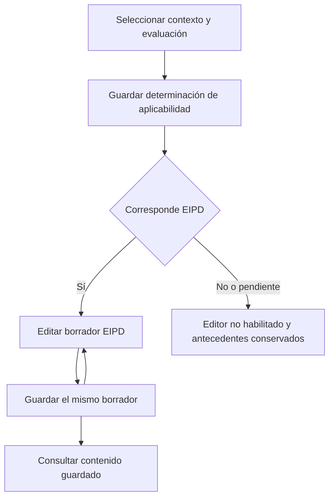
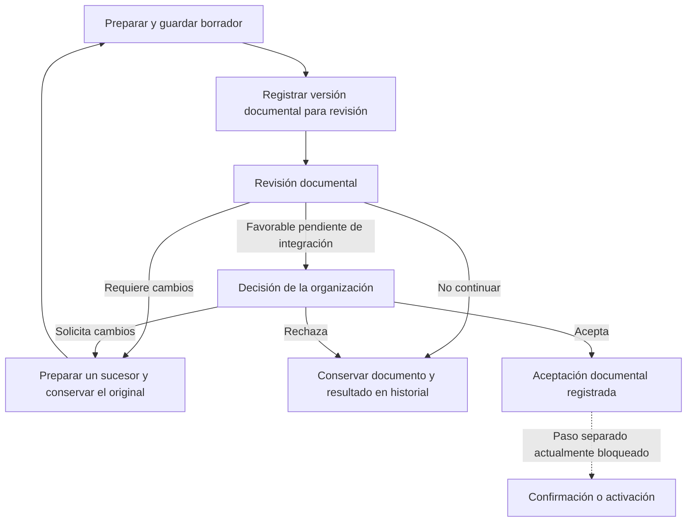

# Ciclo documental de la EIPD en CumpleIA

Guía de generación, edición, versiones, revisión y decisión de la organización.

Fecha de referencia: 25 de octubre de 2026. Base funcional contrastada: `e587da6247e06bb1feca074db1e0bb941c633385`.

Esta guía permite interpretar los formularios y sus historiales sin confundir una operación de guardado con una revisión o una aprobación. Describe el comportamiento actual y separa expresamente el circuito completo que aún debe integrarse para la EIPD general. Es documentación funcional del producto; no establece criterios jurídicos de obligatoriedad ni habilita operaciones.

## 1 Borrador y versión

**Borrador es un estado de preparación. Versión es la identidad de una edición.** Una evaluación puede identificarse como «versión 1» y estar todavía en «borrador». Guardar varias veces ese borrador no crea automáticamente versiones 2, 3 y 4.

| Concepto                         | Qué significa                                                                            | Consecuencia para el usuario                                                                                          |
| -------------------------------- | ---------------------------------------------------------------------------------------- | --------------------------------------------------------------------------------------------------------------------- |
| Cambios sin guardar              | Ediciones pendientes en el formulario abierto.                                           | Navegar dentro del espacio conserva el borrador de la visita; recargar o abrir otra ventana no garantiza recuperarlo. |
| Borrador guardado                | Contenido registrado en el servidor, todavía editable según estado y permisos.           | Puede consultarse después; no acredita revisión ni aprobación.                                                        |
| Versión de evaluación            | Número asignado al crear una evaluación de la serie o finalidad.                         | La versión y el estado deben leerse juntos.                                                                           |
| Resolución documental registrada | Registro conservado e identificado del documento, disponible en el circuito de infancia. | Un sucesor agrega otro registro; no modifica el original.                                                             |
| Revisión documental              | Observación y resultado vinculados a un documento concreto.                              | No cambia por sí sola su contenido ni decide por la organización.                                                     |
| Decisión de la organización      | Evento documental vinculado a una resolución y a una facultad vigente.                   | Aceptar documentalmente no confirma ni activa la EIPD.                                                                |

La evaluación, el documento, la determinación de aplicabilidad y sus revisiones son objetos relacionados, con identidades y secuencias distintas. La interfaz debe indicar siempre a cuál se refiere cada número o estado.

## 2 Recorrido actual del borrador EIPD

Primero se seleccionan organización, tratamiento del RAT, finalidad y evaluación. Después se guarda la determinación de aplicabilidad. El formulario EIPD se habilita cuando la determinación guardada y asociada al contexto indica «Corresponde», y se cumplen los permisos y requisitos aplicables.

| Acción                                               | Efecto actual                                                                                                                                                                       |
| ---------------------------------------------------- | ----------------------------------------------------------------------------------------------------------------------------------------------------------------------------------- |
| Escribir en el formulario                            | Cambia el borrador abierto; todavía no registra esos cambios en el servidor.                                                                                                        |
| Guardar borrador EIPD                                | Actualiza el contenido documental de la evaluación en borrador seleccionada. No crea automáticamente otra versión de evaluación.                                                    |
| Ver vista previa                                     | Permite leer el contenido presentado por el editor. No guarda ni registra una revisión formal.                                                                                      |
| Consultar el documento guardado                      | Lee el contenido registrado en el servidor. Las ediciones pendientes no se incluyen.                                                                                                |
| Actualizar estado guardado sin descartar el borrador | Vuelve a consultar la determinación de aplicabilidad. No guarda el formulario ni crea una revisión. Conserva las ediciones pendientes; con formulario limpio puede cargar lo leído. |

«Pendiente de analizar», «Corresponde», «No corresponde» e «Información insuficiente» son resultados de aplicabilidad, no estados de aprobación del documento. EIPD e infancia se determinan por separado. Cambiar su aplicabilidad conserva los antecedentes; no transforma una revisión anterior en una aprobación para otro contexto.

## 3 Qué se versiona y cuándo

**Evaluación.** El modelo contempla `borrador`, `confirmado` y `reemplazado`. Solo el borrador es actualizable mediante la operación de edición de borradores. Crear una nueva evaluación asigna el siguiente número de su serie; el servidor impide crear otro borrador para la misma finalidad mientras ya exista uno.

En las bases ordinarias implementadas, confirmar una evaluación sucesora cambia la confirmada anterior a «reemplazado». Estos estados del modelo general no significan que el circuito EIPD ya pueda confirmarse: su confirmación y activación permanecen bloqueadas en el alcance actual.

**Documento EIPD general.** Se edita dentro de la evaluación en borrador. El campo «Etiqueta del documento EIPD» es un texto editable (`document_version`): escribir «v2» no crea una nueva evaluación ni una copia histórica inmutable.

**Resolución de infancia.** El registro asigna una versión documental sucesiva y conserva documento, contexto y autoría. Preparar un sucesor permite trabajar sobre una nueva preparación; la vista previa no lo registra. El registro explícito agrega la nueva resolución y conserva las anteriores.

**Determinación de aplicabilidad.** Cada guardado aceptado agrega una revisión propia. No incrementa por ello la versión de la evaluación ni la de una resolución documental. Otros registros, como valoraciones o anexos, tampoco deben confundirse con esas versiones.

Ejemplo ilustrativo de las pruebas de navegación:

| Guardado de aplicabilidad | Resultado      | Evaluación            |
| ------------------------- | -------------- | --------------------- |
| Revisión 1                | Corresponde    | Versión 1 en borrador |
| Revisión 2                | No corresponde | Versión 1 en borrador |
| Revisión 3                | Corresponde    | Versión 1 en borrador |

Son tres revisiones de aplicabilidad, no tres documentos EIPD. Una nota pendiente en otra ventana tampoco pasa al servidor por cambiar la determinación.

## 4 Revisión y decisión son operaciones diferentes

En la navegación conectada, el borrador EIPD general está disponible para consulta. **Su registro completo de revisiones formales todavía no está integrado.** Las revisiones de resoluciones de infancia no deben atribuirse a ese borrador general.

El circuito de infancia conserva resoluciones y revisiones vinculadas a su contenido y contexto. La política de pruebas actual permite registrar revisiones «Requiere cambios» y «No continuar». No debe mostrarse una salida favorable como disponible solo porque aparezca en un esquema más amplio del modelo.

| Operación                          | Resultado registrado                     | Condición o límite                                                               |
| ---------------------------------- | ---------------------------------------- | -------------------------------------------------------------------------------- |
| Revisar resolución de infancia     | Requiere cambios o No continuar.         | Se conserva el original y la revisión del documento específico.                  |
| Registrar decisión de organización | Acepta, Rechaza o Requiere cambios.      | Exige facultad explícita vigente y material documental admitido por el servidor. |
| Consultar una decisión histórica   | Lectura del antecedente y su asociación. | No restituye facultades revocadas ni vuelve vigente un contexto obsoleto.        |
| Confirmar o activar EIPD           | No habilitado en el alcance actual.      | Guardar, revisar o aceptar documentalmente no levanta este bloqueo.              |

Para registrar una decisión, el servidor comprueba la facultad de la persona y que la resolución sea la última y coincida con el contexto y material de infancia exigidos. La decisión queda asociada a esa resolución concreta. No se hereda automáticamente al crear un sucesor.

Si se requieren correcciones sobre una resolución registrada, se prepara y registra un sucesor; el original y sus observaciones permanecen en el historial. «Obsoleto» indica que una asociación ya no coincide con el material o contexto actual; no significa que el antecedente deba borrarse.

## 5 Circuito completo previsto

El siguiente esquema es conceptual. Describe la separación de responsabilidades que debe respetar una integración futura; sus etapas no son todos estados persistidos ni acciones habilitadas hoy para la EIPD general.

La revisión analiza el documento; la organización registra su decisión mediante una persona facultada. La eventual aprobación debe identificar quién decidió, sobre qué documento y con qué antecedentes. No basta un rótulo «Aprobado» sin indicar el objeto y el alcance.

Antes de habilitar el circuito completo del EIPD general, deben definirse e integrarse sus versiones documentales, revisión formal, decisiones y requisitos posteriores. No se debe simular su disponibilidad mediante etiquetas del editor ni extender automáticamente las facultades del circuito de infancia.

Criterios de diseño: identificar el objeto del estado; distinguir pendiente de guardado; vincular cada revisión y decisión al documento exacto; conservar antecedentes; exigir revisión del nuevo contenido o contexto; separar aceptación documental de confirmación y activación.

## 6 Comprobación y referencias

Checklist para validar la comprensión y los futuros ajustes de interfaz:

- [ ] Guardar varias veces el mismo borrador conserva su versión de evaluación.
- [ ] La consulta guardada distingue claramente las ediciones pendientes.
- [ ] La vista previa no crea registros ni presenta éxito de guardado.
- [ ] Consultar aplicabilidad no guarda el formulario ni crea revisiones.
- [ ] Cada revisión de aplicabilidad se diferencia de la versión de evaluación.
- [ ] Una resolución sucesora conserva el original y no hereda su decisión.
- [ ] La revisión documental y la decisión de organización muestran su documento y contexto.
- [ ] Una facultad revocada impide nuevas decisiones, conservando el historial.
- [ ] La consulta de documentos previos sigue disponible cuando deja de corresponder completar el formulario.
- [ ] Ningún guardado, revisión o aceptación habilita confirmación o activación EIPD.

Este checklist es una referencia documental; su inclusión no declara ejecutadas nuevas pruebas ni cierra los pendientes del backlog. Lote 5 y los demás ajustes de navegación conservan su estado previo.

Fuentes del repositorio verificadas en la base indicada:

- [Estados y contratos de evaluación y documento](../../backend/app/schemas/licitud.py): `LegalAssessmentStatus`, `LegalAssessmentDraftCreate`, `LegalAssessmentDraftUpdate`, `EipdResolutionAssessmentV1`.
- [Creación, edición y confirmación de evaluaciones](../../backend/app/services/licitud.py): `create_legal_assessment_draft_v1`, `update_legal_assessment_draft_v1`, `confirm_legal_assessment_v1`.
- [Consulta documental y límite de revisión general](../../frontend/components/licitud/AssessmentFlow.tsx).
- [Aplicabilidad y su historial](../../backend/app/services/navigation_applicability.py).
- [Contratos de resoluciones y revisiones de infancia](../../backend/app/schemas/eipd_child_persistence.py) y [registro de sucesores](../../backend/app/services/eipd_child_persistence.py).
- [Decisiones y facultades](../../backend/app/schemas/organization_acceptance.py) y [validación de decisiones](../../backend/app/services/organization_acceptance.py).
- [Checklist de navegación conectada](navegacion-servidor.md) y [backlog](../backlog.md).

Al cambiar el producto, contrastar esta guía con el código y actualizarla. Las etapas conceptuales no sustituyen contratos ni controles del servidor.
