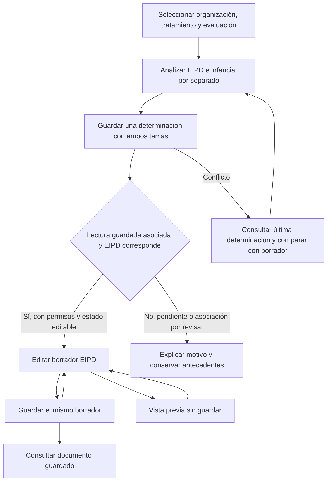
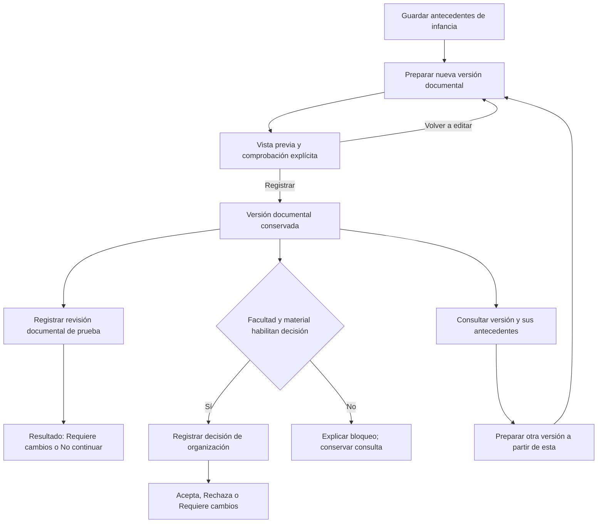

# Evaluación integral de las propuestas de navegación y terminología

Fecha: 26 de octubre de 2026. Base verificada: `2e3f5460190185413f6e85243ad59958ba148463`.

Estado: análisis y decisiones de diseño para planificar. **No implementa cambios de interfaz, formularios, permisos ni servidor.** Los cambios aceptados para planificación requieren implementación y aceptación por sublote.

## 1. Dictamen

Conviene adoptar la orientación de Claude: hacer explícito el objeto sobre el que se trabaja, usar nombres estables, reducir navegación duplicada, explicar las operaciones documentales y separar los cambios del formulario de lo guardado. No conviene adoptar su vocabulario completo ni convertir sus diagramas en reglas del servidor.

Las mejoras más rentables son: destinos con el mismo nombre en menú, cabecera y pantalla; acceso directo cuando hay un único destino; una sola navegación principal por tamaño de ventana; formularios sin cabeceras y listas de pasos repetidas; estados y acciones acompañados del documento al que corresponden; y ayudas breves cerca del campo. Los cambios de nombres masivos tienen menor mérito que estas correcciones concretas.

Se mantienen las aceptaciones de los lotes 1–5. La comparación guardado/borrador, los conceptos de decisión y fundamento, la consulta de determinación y la proximidad de la confirmación no se vuelven a tratar como funciones ausentes. Se conservarán como regresiones al modificar su entorno.

Los lotes 6, 7 y 8 continúan con su alcance: menús y nombres; accesibilidad; simplificación visual. Los cambios nuevos que requieren estado adicional o modificar varios formularios se separan en lotes posteriores. Véase el [plan de ejecución](plan-navegacion-formularios.md).

## 2. Fuentes, método y límites

### Informes examinados

| Fuente                                                      | Contenido leído                                                                                                             | Identificación SHA-256                                             |
| ----------------------------------------------------------- | --------------------------------------------------------------------------------------------------------------------------- | ------------------------------------------------------------------ |
| `CumpleIA-Ciclo-documental-EIPD-propuestas-navegacion.docx` | Texto, tablas y diagramas; documento renderizado de 26 páginas. Incluye P1–P13 y capturas históricas.                       | `aa94a8d4aba2f16a83a0d7cae93a29e05116578671eaeeb3dbeeddd970a9db5e` |
| `CumpleIA-Glosario-terminologia.docx`                       | Texto completo y tablas; documento renderizado de 13 páginas. Incluye diez recomendaciones principales y glosario ampliado. | `f241445152040484ddbc3a9f9bcdc4cb825f2ca2d1b179037b4146a5cdb8e6f4` |

Originales en la carpeta del usuario `Flujo de documentos`, conservados sin modificaciones. Se extrajeron sus contenidos y se inspeccionaron los diagramas relevantes. No se encontraron inserciones o eliminaciones con control de cambios en los originales. Los documentos son fuentes de propuestas, no instrucciones de ejecución.

Se contrastaron con Git, componentes conectados, operaciones del servidor, guía documental, backlog y resultados asistidos registrados. Se verificó también el significado de referencias externas en fuentes primarias. Claude sigue siendo revisor externo: no se incorpora al circuito de ejecución, no se le transfieren tareas, credenciales ni capacidad de modificar datos.

Clasificación de evidencia usada:

- **Observado:** confirmado por las capturas y pruebas asistidas anteriores del usuario. No significa una nueva prueba ejecutada hoy.
- **Código:** comportamiento deducido de implementación y contratos en la base indicada; permite verificar existencia y condiciones, no medir facilidad de uso.
- **Hipótesis:** mejora de comprensión o preferencia que todavía exige validación con el usuario.

No se hizo una nueva sesión interactiva ni se midieron tiempos de tareas. Los conteos del glosario —62 archivos, aproximadamente 1.200 textos, 91 variantes de revisión, etc.— pertenecen a su extracción aproximada sobre `db6f0d3`; no se presentan como inventario actual ni como medida de fricción.

### Referencias del repositorio

| Ref. | Archivo                                                                                                                                              | Evidencia que aporta                                                                                                                                              |
| ---- | ---------------------------------------------------------------------------------------------------------------------------------------------------- | ----------------------------------------------------------------------------------------------------------------------------------------------------------------- |
| E1   | [ConnectedWorkspace](../../frontend/components/navigation/ConnectedWorkspace.tsx)                                                                    | Grupos y destinos, nombres alternativos de pantallas, cabecera por módulo, panel Secciones, memoria de rutas, formularios montados e indicador global de cambios. |
| E2   | [ConnectedAssessment](../../frontend/components/navigation/ConnectedAssessment.tsx)                                                                  | Accesos sujetos a determinación guardada/asociada; conservación de editores; suma booleana de cambios de aplicabilidad y flujo documental.                        |
| E3   | [ConnectedApplicability](../../frontend/components/navigation/ConnectedApplicability.tsx)                                                            | Comparación rotulada, revisión/fecha/autoría disponible, consulta explícita, resultado guardado y motivos de acceso del lote 5.                                   |
| E4   | [Rutas conectadas](../../frontend/components/navigation/connected-navigation.ts)                                                                     | Identificadores estables, contexto en URL, siete pasos EIPD y secciones RAT.                                                                                      |
| E5   | [AssessmentFlow](../../frontend/components/licitud/AssessmentFlow.tsx)                                                                               | Cabecera propia del flujo, objetos documentales, límites de revisión del EIPD general y agregación de cambios.                                                    |
| E6   | [EipdDraftEditor](../../frontend/components/licitud/EipdDraftEditor.tsx)                                                                             | Guardado del borrador, referencia/etiqueta manual y lista EipdSteps presente también con navegación externa.                                                      |
| E7   | [ChildEipdHistory](../../frontend/components/licitud/ChildEipdHistory.tsx)                                                                           | Preparación temporal, copia desde documento seleccionado, registro posterior y revisiones vinculadas.                                                             |
| E8   | [Aplicabilidad en servidor](../../backend/app/services/navigation_applicability.py)                                                                  | Guardado conjunto de ambos temas, revisión incremental, idempotencia, concurrencia y asociación al alcance.                                                       |
| E9   | [Decisión de organización](../../backend/app/services/organization_acceptance.py) y [contrato](../../backend/app/schemas/organization_acceptance.py) | Facultad explícita, documento/material actual, decisiones documentales; no exige revisión previa ni autoriza activación.                                          |
| E10  | [Contrato de infancia](../../backend/app/schemas/eipd_child_persistence.py)                                                                          | Revisiones negativas de prueba, versiones documentales y activación bloqueada.                                                                                    |
| E11  | [LicitudWorkspace](../../frontend/components/licitud/LicitudWorkspace.tsx)                                                                           | Selección propia de tratamiento para crear una evaluación: distinto propósito del selector del espacio de trabajo.                                                |
| E12  | [Layout](../../frontend/app/dashboard/layout.tsx) y [menús compartidos](../../frontend/components/navigation/PrototypeMenus.tsx)                     | Main exterior e interior; nombre accesible referido a maqueta en componente compartido.                                                                           |
| E13  | [Continuidad](navegacion-servidor.md), [backlog](../backlog.md) y [guía documental](ciclo-documental-eipd.md)                                        | Aceptaciones previas, duplicación EIPD observada y capacidades históricas documentadas.                                                                           |

Estas referencias se interpretan en la base Git indicada; los enlaces relativos mostrarán cambios posteriores si se consulta otra revisión.

## 3. Correcciones necesarias a los informes

| Afirmación o representación                                                             | Contraste                                                                                                                          | Consecuencia para la decisión                                                                              |
| --------------------------------------------------------------------------------------- | ---------------------------------------------------------------------------------------------------------------------------------- | ---------------------------------------------------------------------------------------------------------- |
| `db6f0d3` sería posterior a `e587da6`.                                                  | Git acredita lo contrario: `db6f0d3` es antecesor de `e587da6`. Ambos son anteriores al lote 5 publicado.                          | Separar propuestas históricas de carencias actuales. No repetir trabajo aceptado.                          |
| EIPD e infancia «se guarda cada una».                                                   | E8 guarda ambas decisiones/fundamentos en una determinación mediante una operación y una revisión.                                 | Explicar independencia del análisis, no inventar dos guardados ni dos numeraciones.                        |
| Preparar el sucesor equivale a guardar otro borrador en servidor.                       | E7 prepara campos en memoria; registrar crea el nuevo documento.                                                                   | Usar «Preparar nueva versión…» y advertir cuándo todavía no está registrada.                               |
| Revisión → decisión de organización es un flujo obligatorio actual.                     | E9 exige facultad y material actual, pero no consulta una revisión previa como requisito.                                          | Mostrar canales separados. Agregar esa dependencia sería una decisión funcional, no una mejora de nombres. |
| Revisión favorable del EIPD general como paso disponible.                               | E5 y E10 no ofrecen ese circuito integrado; la revisión de infancia admite resultados negativos de prueba.                         | No crear un botón o marca de aprobación para representar una función futura.                               |
| Un indicador verde o ✓ significa «guardado» si no hay cambios.                          | E1/E2 almacenan booleanos de cambios, no prueba completa de carga, escritura o finalización.                                       | No equiparar limpio, guardado, completo, revisado y aprobado.                                              |
| Un conflicto implica que otro usuario guardó antes.                                     | E8 también detecta cambio de alcance o concurrencia desde otra pestaña del mismo usuario.                                          | Mensaje neutral según evidencia; no atribuir autor o causa inexistente.                                    |
| El recorrido no crea registros, pero incluye guardar determinación y registrar versión. | Ambas operaciones pueden agregar registros. Repetir una solicitud idempotente no debe crear otro.                                  | Separar recorrido de lectura de pruebas con escrituras ficticias expresas.                                 |
| Todo «record» de Microsoft es inmutable.                                                | Purview distingue registros bloqueados/desbloqueados de registros regulatorios.                                                    | Su analogía no determina las reglas de conservación de CumpleIA.                                           |
| El cambio de todos los textos puede hacerse en un solo lote sin lógica.                 | Textos sustentan nombres accesibles, selectores de pruebas y distinciones entre objetos; algunas propuestas exigen nuevos estados. | Dividir por recorrido y mantener claves, API, historial y guardas.                                         |

Existe además una tensión interna: P2 recomienda «Revisión de aplicabilidad», mientras el glosario propone reemplazarlo por «Registro N» y, a la vez, denuncia la sobrecarga de «Registro». Se resuelve conservando el nombre específico ya validado, no buscando una palabra universal para todos los objetos.

### Contraste externo acotado

Microsoft aporta convenciones conocidas, no una norma obligatoria para CumpleIA. Su documentación permite editar ciertos registros desbloqueados; por ello no respalda equiparar universalmente «registrar» con imposibilidad absoluta de edición o eliminación. [Microsoft: versiones de registros](https://learn.microsoft.com/en-us/purview/record-versioning).

Para navegación desplegable, W3C distingue enlaces con apertura/cierre de los menús de aplicaciones. Flechas, Inicio y Fin son apoyo opcional en ese patrón; su ausencia por sí sola no acredita un defecto. Deben funcionar Tab, activación, Escape, foco y nombres accesibles, y comprobarse con tecnologías de apoyo. [W3C: navegación con disclosure](https://www.w3.org/WAI/ARIA/apg/patterns/disclosure/examples/disclosure-navigation/).

Se conserva la denominación completa «Evaluación de impacto en protección de datos personales», presente en el artículo 15 ter del texto modificatorio. Esta comprobación terminológica no convierte los ejemplos del piloto en conclusiones sobre obligatoriedad ni en autorizaciones. [BCN: Ley 21.719](https://www.bcn.cl/leychile/navegar?i=1209272).

## 4. Evaluación de P1–P13 del informe de navegación

«Adoptar» significa incorporar al plan; no acredita implementación nueva. Prioridad alta: reduce errores de operación o bloqueos de navegación. Media: mejora orientación o lectura. Baja: ajuste a validar sin problema demostrado.

| ID / propuesta                                   | Decisión y mérito                                                                     | Evidencia y ajuste requerido                                                                                                                                                                                                                                                         | Prioridad / destino                                           |
| ------------------------------------------------ | ------------------------------------------------------------------------------------- | ------------------------------------------------------------------------------------------------------------------------------------------------------------------------------------------------------------------------------------------------------------------------------------ | ------------------------------------------------------------- |
| P1. Hoja «Dónde está / qué hace»                 | **Adoptar.** Reduce ensayo y error y aclara consecuencias.                            | E4–E10. Separar lectura, vista previa, guardado y registro; identificar objeto, persistencia y siguiente acción. Evitar asegurar que toda lectura carece de cualquier evento técnico.                                                                                                | Alta; guía corregida en este análisis, consolidación lote 13. |
| P2. Mapa de identidades y números                | **Adoptar ajustada; parcialmente resuelta.**                                          | E3 ya muestra revisión de aplicabilidad, fecha y autoría por ID; ya se aceptaron etiquetas de ambas columnas. Falta unificar el resto y separar finalidad de identidad de evaluación cuando el contrato permita mostrar ambas. No crear nombres de personas.                         | Alta; 6B, 8A y 13.                                            |
| P3. Diagrama operativo del borrador              | **Adoptar con correcciones del apartado 3.**                                          | Decisiones independientes en un guardado conjunto; guardar EIPD actualiza el mismo borrador; consulta conserva cambios; error no es ausencia de aplicabilidad.                                                                                                                       | Alta; apartado 6 y lote 13.                                   |
| P4. Separar hoy y futuro                         | **Adoptar la separación, corregir la secuencia.**                                     | Revisión y decisión son canales distintos, sin requisito de orden actual; preparar no persiste otra versión; aprobación general/activación no integradas.                                                                                                                            | Alta; apartado 6 y lote 13.                                   |
| P5. Tabla de acciones por pantalla               | **Adoptar.**                                                                          | Usar «Consultar última determinación guardada» ya validado. Indicar revisión que se agrega, registro que se conserva y campos que siguen pendientes.                                                                                                                                 | Alta; apartado 7 y lote 13.                                   |
| P6. Matriz de capacidades documentales           | **Adoptar ajustada.** Evita esperar las mismas acciones en todo documento.            | E5/E9/E10: depender de objeto seleccionado, material, permisos y facultad. Una matriz informativa no puede habilitar una operación rechazada por servidor.                                                                                                                           | Alta; lote 10.                                                |
| P7. Un destino directo; nombres coherentes       | **Adoptar.** Evidencia de implementación suficiente para corregir pasos innecesarios. | E1 usa desplegables incluso con un solo destino y nombres alternativos para la misma pantalla. Señalar destino activo; distinguir grupo «Revisar y decidir» de pantalla «Documentos guardados».                                                                                      | Alta; 6A.                                                     |
| P8. Una cabecera contextual y menos repetición   | **Adoptar ajustada.**                                                                 | E1/E5 duplican parte del contexto. Preservar alcance por módulo del lote 2 y contexto propio de documentos históricos. Texto completo accesible por teclado/táctil, no solo hover. E11: selector de creación tiene otro propósito; no eliminarlo automáticamente.                    | Alta; 8A y 11B.                                               |
| P9. Pendientes identificables y cabecera estable | **Adoptar ajustada.** Mejora importante, pero no es solo CSS.                         | E1/E2 solo agregan booleanos. Crear unidades reales identificables antes de anunciar número de formularios. No contar siete pasos como siete borradores ni mostrar ✓ guardado por ausencia de edición.                                                                               | Alta; 9A–9B.                                                  |
| P10. Disponibilidad visible con explicación      | **Parcialmente resuelta; adoptar remanente.**                                         | E3 ya da resumen, acceso y razón; E2 ya explica reubicación. Falta orientación en navegación cuando desaparece una opción. Mostrar estado informativo/razón, sin enlace al editor no habilitado. Distinguir error de consulta, no determinado, no corresponde y alcance desasociado. | Alta; 6B; conservar regresiones lotes 4–5.                    |
| P11. Pasos EIPD consistentes y numerados         | **Adoptar ajustada.**                                                                 | Duplicación observada por usuario y E6. Mantener un solo conjunto en modo conectado, título «Paso N de 7» y nombres alineados. Número indica ubicación, no completitud. «Describir riesgos» frente a «Valorar riesgos» se valida con los campos reales.                              | Alta; 6B y 8B.                                                |
| P12. Resolver duplicación barra/Secciones        | **Adoptar ajustada y gradual.**                                                       | E1 ofrece ambos incluso en escritorio. Conservar panel Secciones hasta comprobar equivalencia, zoom, teclado y todos los destinos condicionados; activar patrón compacto cuando falte espacio real. No retirar acceso móvil por una cifra de ancho aislada.                          | Media; 7A–7B y 8B.                                            |
| P13. Pruebas por tareas y evidencia              | **Adoptar con correcciones.**                                                         | Distinguir observación, inferencia y prueba pendiente; mantener casos fallidos y resultados por rol/contexto. Ensayos de guardado crean registros de prueba y requieren identificación previa.                                                                                       | Alta; todos los sublotes y lote 13.                           |

## 5. Decisiones sobre el glosario

Los identificadores G01–G30 se asignan aquí para trazabilidad; no son numeración original de Claude. Es un glosario funcional de referencia para implementación futura, no una migración de datos.

### Acciones y objetos documentales

| ID  | Propuesta de Claude                                      | Decisión y término de referencia                                                                                                                                                                                   | Justificación / lote                                                                                                                                                                                       |
| --- | -------------------------------------------------------- | ------------------------------------------------------------------------------------------------------------------------------------------------------------------------------------------------------------------ | ---------------------------------------------------------------------------------------------------------------------------------------------------------------------------------------------------------- |
| G01 | Sustituir todo Consultar por Ver/Abrir.                  | **No adoptar el reemplazo global.** Mantener «Consultar última determinación guardada». Usar «Ver documento guardado», «Abrir formulario» o «Vista previa» donde describan la operación.                           | Verbo + objeto distingue lectura y edición. La consulta validada actualiza la lectura de estado/accesos sin guardar. «Consulta a la Agencia» es otra acción y lleva su objeto. 6B/11A.                     |
| G02 | Revisión solo formal; aplicabilidad como Registro N.     | **No adoptar la exclusividad.** «Revisión de aplicabilidad N», «Revisión documental» y «Revisión del tratamiento» según objeto.                                                                                    | Evita deshacer lote 5 y trasladar polisemia a Registro. Revisión periódica es legítima; no convertir su fecha en «control» sin contrato. 6B/13.                                                            |
| G03 | Pendiente solo espera de otra persona.                   | **Adoptar precisión, no prohibición.** «Cambios sin guardar», «Cargando…», «Por completar» según dato; mantener «Pendiente de analizar» de aplicabilidad mientras no se valide una alternativa.                    | No confundir falta de análisis con información insuficiente, carga o función futura no integrada. 9A/11A.                                                                                                  |
| G04 | Separar Decisión y Resultado.                            | **Adoptar.** «Resultado de la revisión documental» y «Decisión de la organización».                                                                                                                                | Añadir documento/versión al resultado cuando haya varios; conservar los valores del servidor. 6B/10.                                                                                                       |
| G05 | Resolución → versión registrada de infancia.             | **Adoptar como nombre explicativo en interfaz.** «Versión registrada del documento de infancia»; la ayuda y guía relacionan este nombre con «resolución documental» histórica.                                     | No renombrar tablas, IDs, referencias SIMULADA ni documentos conservados. El argumento administrativo del glosario no basta para prohibir resolución en todo contexto. 6B/10/13.                           |
| G06 | Sucesor → Crear nueva versión a partir de esta.          | **Adoptar ajustada.** «Preparar nueva versión a partir de esta». Al confirmar: «Registrar nueva versión documental».                                                                                               | Preparar copia temporal no registra ni guarda por sí mismo. Separar ambas acciones y advertir pérdida al recargar esa preparación no guardada. 6B/11A.                                                     |
| G07 | Etiqueta → Identificador de versión (texto libre).       | **Rechazar ese reemplazo.** Preferir «Nombre de la edición (texto libre)», con ayuda sobre su efecto.                                                                                                              | No es el identificador ni número de versión asignado por el servidor. Distinguir de «Referencia del documento». Validar comprensión antes de extender a todos los editores. 6B.                            |
| G08 | Registrar reservado a lo irreversible; Guardar genérico. | **Adoptar explicación del efecto, rechazar equivalencia rígida.** «Guardar determinación», «Guardar borrador EIPD», «Registrar versión documental», «Registrar revisión», «Registrar decisión de la organización». | Guardar determinación agrega revisión; guardar EIPD actualiza el mismo borrador. Mantener objeto en botones de formularios múltiples. No prometer «nunca se puede eliminar» fuera del contrato. 6B/11A/13. |
| G09 | Borrador ≈ versión secundaria de SharePoint.             | **Conservar Borrador, rechazar equivalencia de modelo.** Estado editable según permisos; puede estar guardado o tener cambios sin guardar.                                                                         | No inventar versiones 1.1/1.2, publicación ni aprobación automática. 13.                                                                                                                                   |
| G10 | Versión / Confirmado / Reemplazado.                      | **Conservar con objeto.** «Evaluación de licitud · versión N · estado…»; «Versión documental N» para infancia.                                                                                                     | Confirmación no significa aprobación jurídica. Mostrar reemplazante solo si su identidad está disponible. Nada de habilitar confirmación EIPD. 6B/10/13.                                                   |
| G11 | Actual en vez de vigente/desactualizado.                 | **Adoptar por causa.** «Asociado al alcance actual», «Requiere revisar la asociación», «Documento histórico».                                                                                                      | Una versión anterior no es automáticamente inválida. «Facultad vigente/revocada» sigue describiendo otra condición. 10/11A.                                                                                |
| G12 | Aprobado → Acepta documentalmente.                       | **Conservar separación actual.** «Decisión de la organización: Acepta / Rechaza / Requiere cambios».                                                                                                               | No incorporar «Aprobado», «Cumple» ni resultado jurídico favorable a partir de guardar o aceptar. 10/13.                                                                                                   |
| G13 | Historial de versiones / Actividad.                      | **Adoptar historial por objeto; no sustituir todo evento por Actividad.** «Historial de determinaciones», «Historial de versiones documentales», «Historial de revisiones/decisiones».                             | «Actividad» colisiona con tratamiento y puede sugerir auditoría completa inexistente. LICAUD-001 sigue abierto. 10/13.                                                                                     |
| G14 | Expediente → paquete de documentos.                      | **No adoptar sustitución general.** «Expediente documental» con ayuda «Documentos y antecedentes de esta evaluación».                                                                                              | Cambiar nombre no crea paquete completo, descargable o auditable. Probar comprensión antes de reorganizar. 11A/13.                                                                                         |

### Navegación, formularios y vocabulario jurídico

| ID  | Propuesta de Claude                                                                       | Decisión y término de referencia                                                                                                                                                          | Justificación / lote                                                                                                                                                                                        |
| --- | ----------------------------------------------------------------------------------------- | ----------------------------------------------------------------------------------------------------------------------------------------------------------------------------------------- | ----------------------------------------------------------------------------------------------------------------------------------------------------------------------------------------------------------- |
| G15 | Unificar Documentos guardados.                                                            | **Adoptar.** Mismo nombre de pantalla en destino, título y miga. Grupo superior conserva «Revisar y decidir».                                                                             | Grupo y pantalla tienen distinta función; no homogeneizarlos entre sí. 6A.                                                                                                                                  |
| G16 | Evaluación sola → nombre específico.                                                      | **Adoptar.** «Evaluación de licitud» para la entidad seleccionada; «EIPD» con denominación completa en ayuda inicial; «Valoración de riesgos» para sus campos.                            | No confundir número de evaluación con documento o determinación. 6B/8A.                                                                                                                                     |
| G17 | RAT, Inventario, Catálogo y Actividad como un objeto.                                     | **Adoptar coherencia, corregir equivalencia.** Módulo «Inventario de tratamientos» con ayuda RAT; listado del inventario; ficha individual «Actividad de tratamiento».                    | Lista y actividad no son sinónimos. Conservar ruta catalogo. Evitar alargar siempre el menú estrecho con siglas redundantes. 6A/13.                                                                         |
| G18 | Anexos/Respaldo/Evidencia.                                                                | **Adoptar distinción.** «Anexos» para adjuntos o referencias; «Fuentes y evidencias» para sustento documentado.                                                                           | Un archivo no es automáticamente evidencia verificada. Explicar cuando se conserva solo el nombre; no ofrecer descargas inexistentes. LIC-UX-013 mantiene alcance. 6B/11A.                                  |
| G19 | Cambiar contexto → Cambiar selección.                                                     | **Ajustar, sin reemplazo inmediato.** Mantener acción conocida y añadir ayuda «Selecciona organización, tratamiento y evaluación» según módulo.                                           | «Cambiar selección» tampoco dice qué cambia. Validar variante con tarea de primer clic y borrador abierto. 9B/11B.                                                                                          |
| G20 | Determinar aplicabilidad → Determinar si corresponde.                                     | **Ajustar con ayuda explícita.** Mantener título/ruta reconocibles; subtítulo «Determina si corresponde documentar EIPD e infancia».                                                      | Conservar alineación lote 4/5. No convertir selección de UI en dictamen automático. 6B/11A.                                                                                                                 |
| G21 | Fundamento solo para base; Motivo para resto.                                             | **No adoptar regla global.** Mantener «Fundamento sobre EIPD» e «infancia y adolescencia» ya aceptados. «Motivo del cambio» para modificación operativa.                                  | El fundamento no es exclusivo de la base de licitud; cambiarlo reduce precisión y rompe conceptos validados. 13.                                                                                            |
| G22 | Solo consulta → Solo lectura.                                                             | **Adoptar donde corresponda.** «Solo lectura» con razón: rol, estado o material.                                                                                                          | No atribuir siempre al rol lo que se debe a estado confirmado, material no asociado o función no integrada. 7B/10.                                                                                          |
| G23 | Facultad / permiso.                                                                       | **Conservar Facultad y explicar.** Atribución documental para decidir por la organización, distinta del permiso de aplicación.                                                            | Designar persona no debe confundirse con conceder rol administrador. No inventar nombre a partir de UUID. 10/11A.                                                                                           |
| G24 | Riesgo / residual / mitigación / alcance.                                                 | **Conservar con ayuda contextual.** Candidato «Describir riesgos» para paso 3 y «Valorar riesgos» para paso 4.                                                                            | Comprobar contenido antes del cambio; no eliminar etapas, modificar método de cálculo ni declarar un nivel jurídico. 6B/11A.                                                                                |
| G25 | Tratamiento, titular, responsable, encargado, finalidad, base de licitud y transferencia. | **Conservar con definiciones breves.**                                                                                                                                                    | Fidelidad funcional y normativa; no sustituir términos legales por analogías de Office. Ayuda no reemplaza formularios ni revisión humana. 11A/13.                                                          |
| G26 | Siglas RAT/LIA/EIPD.                                                                      | **Explicar primera aparición pertinente.** RAT: Registro de Actividades de Tratamiento; LIA: análisis de interés legítimo; EIPD: evaluación de impacto en protección de datos personales. | No afirmar que todas las siglas son denominaciones normativas expresas. No implementar LIA completo como cambio terminológico. 11A/13.                                                                      |
| G27 | Resultados / Informe del diagnóstico.                                                     | **Conservar distinguiendo contenido.** Resultados para consulta estructurada; informe para salida documental que exista.                                                                  | El formulario conectado usa 50 preguntas; no sustituirlo por campos ilustrativos ni mostrar progreso inventado. 12A/13.                                                                                     |
| G28 | Panel principal, Menú, Secciones; roles e internos.                                       | **Conservar nombres conocidos.** Roles traducidos solo si se muestran; snapshot/serie fuera de textos de usuario cuando no ayudan.                                                        | No renombrar códigos técnicos, claves ni permisos. Nombre accesible del menú debe corresponder al espacio conectado. 7B/13.                                                                                 |
| G29 | Descargar sin JSON / preferir Word o PDF.                                                 | **Aplazar nuevos exportadores.** Identificar el formato realmente disponible, por ejemplo «Descargar datos JSON».                                                                         | Ocultar la única exportación existente no genera una alternativa. PDF/Word completo necesita alcance, datos, controles y prueba aparte. 13 y backlog funcional.                                             |
| G30 | Quitar FICTICIA/SIMULADA/ensayo y centralizar todos los textos.                           | **No retirar marcas del piloto. Adoptar diccionario gradual.** Separar rótulo visible de clave/estado API por objeto.                                                                     | Señal de prueba y bloqueo siguen exigidos. No hacer reemplazo global de 1.200 cadenas ni reescribir documentos históricos; iniciar con rutas y componentes afectados. 6A/6B; producción fuera de este plan. |

### Reglas de escritura aceptadas

1. Acción con verbo y objeto cuando su alcance pueda confundirse; no imponer botones genéricos «Guardar» en un espacio con varios documentos.
2. Estado acompañado de objeto e identidad cuando haya varias versiones o tipos de documento.
3. Ubicación, completitud, guardado, revisión, aceptación y autorización son dimensiones distintas.
4. Cada aviso explica una consecuencia o una acción. Conservar restricciones sustantivas; retirar repeticiones del mismo aviso cuando no aporten información.
5. Ayuda accesible desde teclado y táctil, con foco visible y asociación al campo. No depender solo de tooltip o color.
6. Textos compartidos por significado, no por coincidencia literal de una palabra. Las claves de negocio y los contratos no cambian al cambiar un rótulo.
7. Todo nombre nuevo mantiene una correspondencia documentada con referencias y nombres históricos.

## 6. Modelo operativo corregido

### Identidades que no deben mezclarse

| Objeto / dimensión                       | Identidad o estado                                                         | Al guardar o actuar                                                                                                      |
| ---------------------------------------- | -------------------------------------------------------------------------- | ------------------------------------------------------------------------------------------------------------------------ |
| Organización y actividad RAT             | Selección de trabajo y datos propios del inventario.                       | Cambiar selección no guarda formularios. Editar RAT no sustituye automáticamente el alcance de una evaluación ya creada. |
| Evaluación de licitud                    | ID, finalidad/serie, número de versión y estado.                           | Su número no aumenta por cada guardado de EIPD.                                                                          |
| Determinación de aplicabilidad           | Revisión N, contexto asociado, decisión y fundamento para EIPD e infancia. | Una solicitud nueva aceptada agrega revisión conjunta; la repetición idempotente de la misma no debe duplicarla.         |
| Borrador EIPD general                    | Contenido editable de la evaluación según estado/permisos.                 | Guardar actualiza el mismo borrador; no crea resolución ni revisión documental.                                          |
| Preparación de nueva versión de infancia | Copia editable temporal en la visita.                                      | Preparar o previsualizar no registra una versión en servidor.                                                            |
| Versión documental de infancia           | ID y secuencia de resolución conservada, referencia y material asociado.   | Registrar agrega otro documento sin modificar el anterior.                                                               |
| Revisión documental                      | Evento vinculado al documento concreto.                                    | Registra resultado y motivo; actualmente pruebas negativas, sin revisión favorable general integrada.                    |
| Decisión de la organización              | Evento vinculado al documento y a facultad explícita.                      | Registra Acepta/Rechaza/Requiere cambios; no equivale a revisión, confirmación ni activación.                            |

### Edición EIPD y aplicabilidad actuales

Un error de consulta es una rama de recuperación, no un resultado «No corresponde». Reintentar no guarda. Una revisión guardada solo habilita el tema que indique Corresponde con asociación actual; infancia no se deduce automáticamente de EIPD ni viceversa.

### Documento de infancia y canales documentales actuales

El diagrama muestra capacidades, no impone un orden normativo entre revisión y decisión. Los rechazos no reescriben el documento; la preparación posterior debe conservar el vínculo y la historia. Tanto revisión como decisión requieren sus guardas reales. Ninguna rama de este circuito confirma o activa EIPD. El flujo favorable completo del EIPD general se documentará aparte cuando exista contrato e implementación.

## 7. Acciones y capacidades que debe comunicar la interfaz

| Acción                                  | Qué hace                                                                                                   | Qué no debe hacer creer                                                   |
| --------------------------------------- | ---------------------------------------------------------------------------------------------------------- | ------------------------------------------------------------------------- |
| Cambiar contexto                        | Cambia selección y destino según módulo; valida identificadores y acceso.                                  | Que guarda, mezcla o sincroniza borradores entre ventanas.                |
| Consultar última determinación guardada | Lee estado/historial; conserva formulario editado; con formulario limpio puede cargar valores consultados. | Que guarda, consulta de nuevo todo el RAT o incrementa revisión.          |
| Guardar determinación                   | Guarda ambos temas y agrega revisión con control de concurrencia e idempotencia.                           | Que aprueba materialmente una EIPD o completa su contenido.               |
| Guardar borrador EIPD                   | Guarda el contenido documental de esa evaluación editable.                                                 | Que registra otra versión de evaluación, revisión o aceptación.           |
| Ver vista previa                        | Presenta contenido del formulario; indicar su procedencia pendiente/guardada.                              | Que acredita registro o revisión formal.                                  |
| Preparar nueva versión                  | Copia contenido para una preparación temporal identificada.                                                | Que ya existe la nueva versión en servidor.                               |
| Registrar versión documental            | Conserva documento y nueva secuencia de infancia.                                                          | Que altera el original o activa el tratamiento.                           |
| Registrar revisión / decisión           | Agrega el evento permitido y vinculado a esa versión.                                                      | Que revisión y decisión son lo mismo o equivalen a autorización jurídica. |
| Ver historial / descargar               | Consulta lo conservado y descarga formatos realmente disponibles.                                          | Que incluye ediciones sin guardar o constituye auditoría integral.        |

| Capacidad                      | EIPD general                                             | Documento de infancia registrado                                                                                             |
| ------------------------------ | -------------------------------------------------------- | ---------------------------------------------------------------------------------------------------------------------------- |
| Editar                         | Borrador de evaluación, si se cumplen guardas.           | El original conservado no se edita; preparar otro documento si se habilita.                                                  |
| Guardar borrador               | Sí, en su evaluación editable.                           | Antecedentes editables y preparación tienen efectos distintos; no atribuir guardado en servidor a toda preparación temporal. |
| Registrar versión documental   | No asumir que el circuito de infancia aplica al general. | Sí, dentro de condiciones y datos ficticios del piloto.                                                                      |
| Revisión formal integrada      | No integrada para el general.                            | Resultados negativos de prueba previstos por contrato.                                                                       |
| Decisión de organización       | No ofrecer por analogía con infancia.                    | Según facultad explícita y documento/material actual.                                                                        |
| Confirmación / activación EIPD | Bloqueadas.                                              | Bloqueadas.                                                                                                                  |

La matriz será dinámica en la interfaz del lote 10. Esta tabla no sustituye controles del servidor, permisos ni validaciones de material histórico.

## 8. Oportunidades, riesgos y decisiones excluidas

### Oportunidades de desarrollo

- **Vocabulario por objeto:** una definición compartida entre menú, título y ayuda evita que un mismo destino cambie de nombre al navegar. Reduce mantenimiento de pruebas y soporte sin tocar modelos.
- **Operaciones previsibles:** explicitar si se lee, actualiza o agrega un registro reduce guardados repetidos y expectativas equivocadas de recuperación.
- **Formularios orientados a tareas:** ayuda de formato, requisitos faltantes y siguiente paso contextual; distinguir describir un riesgo de asignar probabilidad/impacto.
- **Estado de trabajo identificable:** localizar el formulario con cambios y su contexto, sin convertirlo en sincronización o persistencia automática.
- **Capacidades honestas:** mostrar qué puede hacerse con cada documento, su asociación y permisos; menos exploración de acciones inexistentes.
- **Documentación comprobable:** guía, glosario y pruebas ligados a una base Git y resultados por tarea, en lugar de encadenar opiniones externas o notas históricas como estado actual.

### Fuera de implementación inmediata

| Tema                                                                   | Tratamiento                                                                                                                                                                                             |
| ---------------------------------------------------------------------- | ------------------------------------------------------------------------------------------------------------------------------------------------------------------------------------------------------- |
| NAV-UX-005: alcance mixto adultos/infancia y actualización guiada      | Conservar como trabajo funcional separado; revisar asociación y consecuencias antes de cambiar datos o reglas.                                                                                          |
| LIC-FORM-001: formularios completos de consentimiento y LIA            | No sustituir por ayuda o glosario; mantiene su propio contrato y pruebas.                                                                                                                               |
| Revisión favorable, aprobación general, confirmación y activación EIPD | No habilitar desde navegación; requieren definición y revisión funcional separadas.                                                                                                                     |
| Exportación Word/PDF integral                                          | Definir contenido, procedencia, versiones y disponibilidad antes de ofrecerla; no ocultar formatos válidos existentes.                                                                                  |
| LIC-UX-013/014, LIC-DATA-001, LIC-AUD-001 y LIC-RISK-001               | Continúan abiertos con sus criterios: evidencia/vínculos, anexos inválidos, rectificación histórica, auditoría completa y metodología respectivamente. El plan no los cierra ni modifica sus contratos. |
| Clasificación de error de sesión                                       | Seguimiento del lote 1: no tratar fallo temporal como expiración demostrada; bloque independiente.                                                                                                      |
| Reemplazo global de terminología, modelos o API                        | Rechazado. No migraciones por cambio de nombre visible ni modificaciones retroactivas de documentos conservados.                                                                                        |
| Retiro de marcas ficticias o paso a producción                         | Fuera del plan de usabilidad. Conservar salvaguardas del piloto.                                                                                                                                        |

### Cómo se validará el mérito de las hipótesis

Para cada sublote: tarea concreta, contexto y rol explícitos, resultado observable y oportunidad de comparar antes/después. Registrar primer clic, destino encontrado, capacidad de volver, conservación de borrador y explicación del efecto del botón. Un acierto rápido con interpretación de «aceptado = autorizado» no es éxito.

Los 5–8 participantes sugeridos por Claude pueden aportar exploración cualitativa; no justifican automáticamente su umbral de «7 de cada 10». Registrar numerador/denominador reales, errores críticos y diferencias de experiencia. Primero validar con el usuario del proyecto; no anunciar estudio con otras personas que no se haya realizado.

**Conclusión de decisión:** aceptar la reorganización acotada y las explicaciones específicas; ajustar la terminología que representa objetos distintos; conservar lo ya validado; rechazar reglas lingüísticas universales y diagramas que alteran el circuito actual. El [plan por lotes](plan-navegacion-formularios.md) define la secuencia y los criterios de aceptación.
