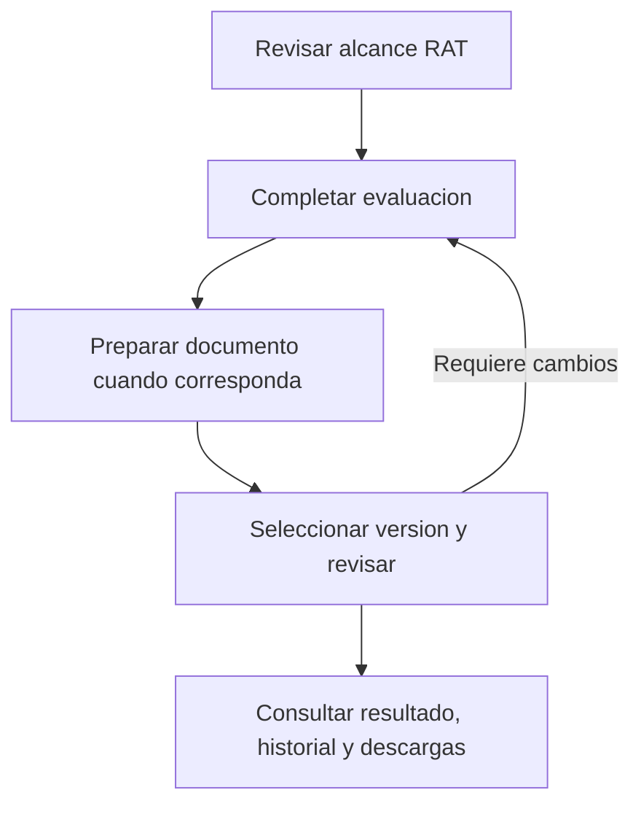

# Propuesta de experiencia de licitud

Estado vigente: recorrido conectado implementado y probado; ampliado con
valoración estructurada y anexos de respaldo. [Contrato actual y límites](m3-t1-riesgos-anexos.md).
La propuesta y las versiones de maqueta siguientes son antecedentes del diseño;
no amplían aprobación jurídica ni activación EIPD.

## Problema observado

La prueba manual exigio instrucciones para encontrar acciones, diferenciar notas
editables de registros historicos y distinguir revision negativa de decision de
organizacion. Se completo un fundamento sobre version 2 consultando version 1.
ChildAdolescentPage apila expediente, editor e historial. ChildEipdHistory mezcla
creacion, consulta, decision de organizacion, copia sucesora y revision negativa.
OrganizationAcceptancePanel incluye facultades y decisiones dentro de la consulta.
Varios botones carecen de estilo reconocible. Guardar fundamento exige recargar
para actualizar paneles inferiores. El dossier presenta contenido JSON como vista
principal. La estructura actual obliga al usuario a conocer el modelo interno.

## Navegacion propuesta

Cabecera persistente: organizacion, tratamiento, finalidad, evaluacion y version,
estado documental y aviso de entorno de pruebas. Separar claramente version de
la evaluacion, numero de resolucion y etiqueta documental; nunca un unico numero
ambiguo. En revisiones indicar siempre documento/referencia/version objetivo.

Cuatro pestanas por intencion:

| Pestana | Contenido | Accion principal |
| --- | --- | --- |
| Resumen y siguientes pasos | Esquema, situacion por seccion, pendientes y motivos | Continuar tarea pendiente |
| Completar datos | Alcance RAT asociado, base/fundamento, LIA disponible, infancia y preparacion documental segun corresponda | Guardar borrador y continuar |
| Revisar documentos | Seleccion explicita de documento/version, lectura y formularios separados de revision y decision organizacional | Registrar revision o decision identificada |
| Historial y descargas | Versiones, revisiones, decisiones, facultades y expediente | Consultar o descargar |

Facultades: acceso secundario Gestionar facultades visible segun permisos,
fuera del formulario de revision. La persona revisora ve su estado y motivo de
bloqueo; la administracion puede gestionar otorgamiento/revocacion. Mantener
lecturas historicas disponibles segun permisos actuales.

## Esquema de trabajo

El retorno al editor conserva el historial; un documento registrado se corrige
preparando otra version. La revision y la decision organizacional tienen facultades
y contratos propios; este esquema no impone una secuencia juridica universal.

Revisar alcance RAT -> Completar evaluacion -> Preparar documento/version cuando
corresponda -> Revisar version seleccionada -> Registrar revision/decision segun
facultad -> Consultar historial/exportar. Requiere cambios vuelve a preparar
borrador o nueva version; no modifica el registro historico. No continuar mantiene
el resultado visible sin ofrecer activacion. Los pasos documentales no equivalen
a autorizacion juridica y no todos aplican a todas las evaluaciones.

Resumen ofrece siguiente accion contextual, no un porcentaje general de cumplimiento.
Ejemplos: completar fuente, guardar cambios, seleccionar version, revisar documento
o facultad revocada. Estado separado: sin iniciar, borrador guardado, cambios sin
guardar, pendiente de revision, requiere cambios, no continuar y solo consulta.
No mostrar revisado/aprobado por el mero guardado, ni inferir una EIPD obligatoria
solo por nombre de tratamiento o seleccion de infancia. Usar contrato/diagnostico
servidor y explicar cuando no permite determinar el siguiente paso.

## Completar datos

Secciones cortas con indice propio: alcance, base/fundamento, analisis disponibles,
infancia cuando corresponda, documento EIPD cuando proceda. Por seccion indicar
objetivo, quien completa, campos requeridos para guardar y pendientes documentales.
Mostrar resumen RAT en lectura y enlace para editarlo; advertir diferencias con
el snapshot asociado sin sobrescribirlo. No presentar nueve campos LIA como un
cuestionario juridico completo. Distinguir borrador editable y version registrada.
Guardar borrador y continuar solo avanza tras respuesta confirmada; guardar no
registra automaticamente resolucion, revision ni decision inmutable.

## Revisar documentos

Lista de versiones con referencia y estado, seleccion visible y lectura resumida
antes del formulario. Dos acciones identificadas: Revision del documento (contrato
actual solo requiere cambios/no continuar) y Decision documental de organizacion
(con facultad vigente). No son pasos obligatoriamente consecutivos ni equivalentes.
Mostrar fecha, alcance y version objetivo junto al boton final; confirmar objetivo
al registrar un evento inmutable. Crear nueva version desde esta seccion conduce
al editor, informa origen y no guarda automaticamente.

Cada bloqueo explica su causa junto al control: falta declaracion ficticia,
facultad revocada, solo lectura, material cambiado, resultado incierto o escritura
de pruebas deshabilitada. Distinguir permiso de editar, revisar y decidir. No
preseleccionar una decision favorable. No ocultar el historial al revocar facultad.

## Presentacion y estados

Botones primarios visibles, secundarios con borde y enlaces solo para navegacion.
Etiquetas junto a controles, ayudas cortas, campos condicionales justificados,
resumen legible antes de detalles tecnicos/JSON. Aviso global persistente de pruebas
y avisos especificos en acciones, evitando repetir parrafos identicos por panel.
Fechas locales legibles con UTC accesible en detalle; hashes en detalle tecnico.

Datos cargados del servidor indican borrador guardado; editar marca cambios sin
guardar. Al cambiar pestana o version, preservar borrador o permitir guardar/seguir
editando/descartar explicitamente. Nunca perder datos por desmontar componentes.
Tras guardar, refrescar datos y diagnosticos dependientes automaticamente; impedir
operaciones contra material obsoleto y no mostrar exito ante respuesta incierta.
Navegacion por teclado, foco visible, roles de pestanas, enlaces directos que
conserven organizacion/evaluacion/version y vista movil sin formularios comprimidos.

## Implementacion propuesta y verificacion

Un bloque coherente de experiencia: estructura de cuatro pestanas y esquema,
separacion de editor/consulta/revision/facultades, contexto de version compartido,
estados de guardado/bloqueo y refresco de dependencias. Reutilizar servicios y
contratos existentes; no cambiar politicas ni migrar historiales. Separar el criterio
de completitud de fuentes como tarea de validacion con contrato propio.

Antes de implementar: maqueta navegable con escenarios adulto, infancia y facultad
revocada para comprobar nombres y transiciones. Luego implementacion y pruebas
centradas en riesgos: cambios entre pestanas sin perdida, version objetivo exacta,
roles y revocacion, contexto actualizado tras guardar, respuestas inciertas,
conservacion de historial y lectura/exportacion con escrituras deshabilitadas.
Validacion asistida: usuario identifica sin ayuda donde completar, donde revisar,
que version revisa, por que una accion esta bloqueada y que sigue. EIPD y datos
reales bloqueados antes y despues. No ampliar alcance a habilitar aprobaciones.

## Aceptacion y siguiente entrega

El usuario acepta la propuesta y autoriza su documentacion, commit y push.
Proximo entregable: maqueta navegable de las cuatro pestanas con los escenarios
adultos, infancia y facultad revocada; validar claridad de nombres, version objetivo
y siguiente accion antes de modificar los formularios existentes. La maqueta debe
identificar los datos simulados y no registrar eventos ni cambiar configuraciones.
La implementacion y sus pruebas se ejecutaran como bloque posterior; no se marcan
como realizadas por aprobar o publicar este documento.

Criterios de aceptacion del bloque de experiencia:

- Identificar donde completar, revisar y consultar historial sin instrucciones externas.
- Mostrar siempre documento y version objetivo junto a una revision o decision.
- Conservar cambios al navegar y distinguir guardado confirmado, cambios pendientes
  y resultado incierto; sin recarga manual obligatoria tras guardar.
- Explicar el motivo de cada bloqueo y mantener consulta historica tras revocacion.
- Mostrar pasos aplicables y siguiente accion sin equivaler avance a aprobacion juridica.
- Mantener permisos de servidor, aislamiento, registros inmutables y bloqueos EIPD/datos reales.
- Verificar teclado, foco, pantallas pequenas y los tres escenarios con el usuario.

Backlog de referencia: LIC-UX-004 integra esta reorganizacion y recoge LIC-UX-002,
LIC-UX-003 y el patron de guardado RAT-UX-001 cuando corresponda. RAT-VAL-001
mantiene su propio contrato de completitud; no se considera resuelto por el rediseno.

## Maqueta navegable disponible — version 3

Ruta protegida `/dashboard/licitud/maqueta`, acceso desde Bases de licitud.
Seleccionar tratamiento/finalidad antes de cuatro pestanas. Ejemplos opcionales
solo precargan seleccion; facultad simulada vigente/revocada sigue independiente.
No usa API/DB ni cambia permisos, configuracion o formularios operativos.

V3, 19/10/2026: Completar datos conserva solo Alcance del RAT y Base/fundamento;
Infancia se agrega cuando corresponde al ejemplo. Numeracion consecutiva segun
secciones visibles. Resumen de alcance en cuatro lineas. Aviso de cambios sin
guardar dentro del formulario, destacado; no implica persistencia en servidor.

Preparar documento para revision es una accion, no otra seccion dedicada a notas.
Muestra referencia/version propuesta (inicia DEMO-3, tras dos fixtures), organizacion,
tratamiento, finalidad, titulares, categoria, fuente, base, fundamento y analisis de
infancia cuando existe. Notas especificas opcionales incluidas en la vista previa.
Pendientes explicitos: campos vacios y analisis/revision juridica/evidencias que el
ejemplo deja pendientes; no es diagnostico juridico exhaustivo. No exigir notas.

El responsable ficticio revisa la vista previa y puede volver a fundamento,
infancia o alcance. Registrar exige confirmar lectura del contenido mostrado;
si cambia, la confirmacion se invalida. Es revision preparatoria del ensayo, no
aceptacion juridica, otorgamiento de facultad ni aprobacion EIPD. La revision del
documento y decision organizacional siguen separadas en Revisar documentos.

Simular registro conserva una copia completa independiente del borrador, solo en
memoria de la visita. Queda pendiente de revision; historico consultable con
version explicita. Editar despues no modifica la copia anterior; preparar/registrar
otra crea DEMO-4 y siguientes. Crear nueva version a partir de DEMO-N copia
exactamente la version seleccionada (incluidos notas/analisis), no el ultimo borrador.
Al inicio de edicion muestra origen y motivo del cambio obligatorio; el motivo
anterior no se hereda. Si hay cambios sin guardar, exige confirmar reemplazo o
conservar borrador; no descarta silenciosamente. Origen/motivo quedan en la copia
y descarga; cambios invalidan lectura preparatoria. Emitir revision sobre DEMO-N
recoge observaciones sobre ese documento registrado, separadas del motivo de la
actualizacion. No exige revision negativa previa para crear otra version.
Los siete desplegables tienen ayuda contextual bajo el control, vinculada por
aria-describedby y actualizada con aria-live: tratamiento, finalidad, facultad,
base propuesta, version, tipo de actuacion y resultado. Explican cada alternativa,
seleccion inicial y dependencias; distinguen observacion, posicion organizacional,
correcciones y recomendacion de no continuar. No recomiendan una base juridica
ni amplian permisos. Pruebas dirigidas cubren todas las alternativas y version local.
Nuevas versiones por tratamiento/finalidad; observaciones por version. Doble contexto: version de evaluacion 1 y version
documental explicita. Facultad revocada bloquea decision organizacional, conserva
edicion/consulta del ensayo y no otorga permisos reales.

Historial incluye fixtures y versiones de la visita. Solo la version seleccionada
para descarga lleva fondo celeste, aria-current y etiqueta explicita; las demas
tienen fondo neutro, incluidas las creadas durante la visita. Comprobacion dirigida
en Chromium: resaltado, etiqueta, nombre de archivo y contenido JSON coinciden
al alternar DEMO-1, DEMO-2 y DEMO-3. JSON de fixture excluye textos
editados; JSON de version simulada incluye su copia completa, notas y pendientes,
no cambios posteriores del borrador. Exporta tipo ficticios, contains_user_edits
segun origen, lectura preparatoria simulada, persisted_events=0 para servidor y
numero de versiones locales; authorizes_action=false, activation=deshabilitada,
allows_real_data=false. No es un expediente operativo ni prueba de aceptacion.

Nada se persiste en navegador/servidor: recargar reinicia borradores/versiones.
Enlace a version local inexistente tras recarga informa y vuelve al fixture DEMO-2.
Fragmento conserva seleccion/version, no contenido. Enlaces V1/V2 compatibles.
Roles de pestanas, flechas/Home/End, foco y vista movil conservados.

Visita guiada del usuario sobre V2: observadas seleccion/edicion, conservacion al
navegar, observaciones por version, descarga ficticia, bloqueo organizacional con
facultad revocada y edicion de infancia. Usuario confirma en prueba controlada
separacion y conservacion de borradores entre finalidades durante la visita; no
acredita persistencia tras recarga. Hallazgos de presentacion integrados en V3.

Validacion local V3 consolidada sobre ada6d45: 18 Chromium del bloque aprobadas; tipos frontend, ESLint de
archivos modificados, Prettier y git diff --check aprobados. Nuevos casos verifican
contenido/faltantes, lectura invalidada al cambiar, regreso a editar, copia completa
con infancia/notas, descarga exacta, nuevas versiones sin mutar antiguas, aislamiento
por finalidad y reinicio al recargar. Casos de copia desde una version anterior,
proteccion de cambios pendientes, motivo obligatorio y trazabilidad en descarga
aprobados. Vista de origen/motivo y preparacion inspeccionada. Capturas de preparacion inspeccionadas en
390 px y 1280 px. Suite existente: `npx playwright test e2e/licitud-prototype.spec.ts`.
Sin cambios backend, sin repetir DB ni pruebas amplias locales. Ruta protegida
comprobada: sin sesion devuelve 307 a /login. CI funcional de ada6d45
39321154265 aprobada (backend, frontend e integrada); Handoff 39321154299 aprobado.
No atribuir a otro commit estas ejecuciones.

Usuario confirma el ciclo DEMO-1 a DEMO-3: origen/motivo y fundamento conservados
en JSON, original intacto, resaltado de seleccion correcto y observaciones separadas
al alternar versiones. Se comprobaron tambien regreso a editar y notas opcionales
vacias. Las revisiones terminan en vista previa, no se registran ni cambian historial.
Bloque de maqueta navegable completado. Pendiente como bloque posterior trasladar
el diseno a formularios operativos con sus contratos y validacion propia. LIC-UX-004 abierto;
RAT-VAL-001 sigue separado. EIPD/datos reales bloqueados; sin merge/despliegue.

## Integracion del recorrido con servidor — 19/10/2026

La ruta de cada evaluacion usa AssessmentFlow con cuatro pestanas y secciones
Alcance/Base/Infancia cuando el contexto guardado o documento la requiere.
Los componentes se mantienen montados: navegar no descarta cambios ni mezcla
edicion con revision/descarga. URL conserva organizacion/evaluacion y fragmento;
flechas/Home/End cambian foco. Resumen RAT en lineas separadas y ayudas en entrada/base.
Guardado confirmado actualiza diagnostico de infancia, invalida paquete descargable
y consulta de resoluciones sin desmontar borradores. Error conserva formulario.
Preparar requiere guardar cambios base/infancia, vista previa del contexto guardado
y documento, lectura ficticia que se invalida al cambiar contenido o contexto.
Numeracion definitiva la asigna servidor; resoluciones inmutables existentes.
Copia exige confirmar reemplazo de documento pendiente; observaciones conservadas
por resolucion durante navegacion. Descarga usa expediente API, no formulario.

Limite explicito: registro documental conectado usa contrato EIPD sucesor de infancia.
No crea adopcion/versionado autonomo de RAT/LIA ni persiste los campos de origen/motivo
de la maqueta como metadata nueva. No se inventa una FK ni se amplia aceptacion a
otros documentos. Lecturas/escrituras conservan validacion de servidor, RLS y opt-in
ficticio actual; no se habilita la escritura temporal local. Usuarios de consulta
y expedientes historicos permanecen de solo lectura. EIPD no confirma ni activa.

## Bloque EIPD documental guiado y conectado — 19/10/2026

Documentar EIPD conecta el contrato existente eipd_resolution_assessment al PATCH
del borrador. Seis secciones: tratamiento/alcance, necesidad/proporcionalidad,
riesgos, medidas, fuentes/evidencias y riesgo residual/seguimiento. Conserva todo
el documento al navegar, incluidas relaciones riesgo-medida, evidencias y notas.
Ayudas de opciones no recomiendan una base ni calculan riesgo. Vista previa no
registra una resolucion; guardar solo actualiza el borrador. Revisar documentos
muestra la copia guardada, separada de resoluciones de infancia y sus revisiones.

Cliente excluye metadata context_binding de entrada, rechaza documento incompatible
sin sustituirlo y compara respuesta con contenido enviado antes de declarar exito.
Error conserva campos; respuesta incierta bloquea repeticion. Diagnostico del servidor
se actualiza sin reiniciar formularios; ausencia/incompatibilidad no acredita
preparacion. Paquete descargable se invalida tras guardar para consultar uno nuevo.
No agrega endpoints, migraciones, permisos, politica ni escrituras locales habilitadas.

Validacion del bloque integrado: 71 Chromium de componentes afectados (18 editor de
infancia, 32 historial, 12 aceptacion/facultades y 9 workspace/EIPD), tipos,
ESLint/Prettier, Ruff/Black del test SQL. Runner fijo run_licitud_workspace_tests:
4 aprobadas, incluyendo Chromium/API/PostgreSQL real con riesgo R1, medida M1,
seguimiento y reapertura. SQL comprueba contenido EIPD/LIA y confirmed_at=null.
Capturas con CSS real inspeccionadas en 390 y 1280 px; no prueba de dispositivo
fisico ni de todas las pantallas Next con sesion externa. Datos ficticios unicamente.

Limites de cierre: completo este bloque de interfaz/persistencia documental, no
EIPD juridica u operativa integral. Registros inmutables/revisiones conectados siguen
siendo los contratos de infancia; aceptacion/adopcion autonoma de RAT/LIA y metadata
estructurada de origen/motivo de la maqueta no se incorporan por inferencia.
Pendientes: validacion asistida del recorrido conectado, contrato de esos artefactos,
cobertura de revision EIPD general y aceptacion juridica humana/fuentes/evidencias
aplicables. No habilita confirmacion, datos reales, activacion, merge ni despliegue.

## Validacion asistida del recorrido conectado — 20/10/2026

Usuario confirma alcance separado, aviso de cambios pendientes y conservacion del
fundamento al navegar entre pestanas con trabajadores ficticios. Las capturas
aportadas aun muestran cambios sin guardar; no acreditan por si solas persistencia
tras recarga. Confirmacion de guardado de base/fundamento resaltada junto al boton,
solo tras respuesta exitosa y mientras no haya nuevas ediciones. Validacion asistida
continua; EIPD bloqueada, sin merge/despliegue.

Fuentes del expediente: una entrada visible Ley 21.719 enlaza a BCN; la publicacion
original y SHA-256 quedan agrupados en sus antecedentes desplegables. Conserva
fuentes e identidad del JSON sin modificar evidencias ni contratos del servidor.

Pendiente de UX confirmado durante validacion asistida: la confirmacion de Guardar
borrador EIPD existe arriba del formulario, pero pasa inadvertida desde el boton.
Mostrarla destacada junto a la accion de guardado, solo tras confirmacion del
servidor y retirarla ante nuevas ediciones. Solicitud resuelta en el bloque de presentacion descrito a continuacion. No confundir esta observacion con fallo de persistencia.

Revision conectada: oculta resoluciones/instrucciones de infancia para alcance adulto
solo tras consulta exitosa de historial vacio; conserva acceso cuando el alcance
incluye infancia/adolescencia o hay antecedentes. Error de consulta sigue visible.
Borrador EIPD general permanece consultable y aclara que sus revisiones formales
no estan integradas. Persistencia EIPD tras recarga comprobada manualmente por el
usuario (referencias, etiqueta y preparado por); activacion permanece bloqueada.

## Punto de pausa de validacion asistida — 20/10/2026

Usuario solicita detener las pruebas y retomarlas en unas horas. No hay pruebas
en ejecucion ni se programa continuacion automatica.

Comprobado con datos ficticios de trabajadores adultos: alcance RAT separado;
base/fundamento conserva ediciones entre pestanas, guarda y recupera tras recarga;
borrador EIPD conserva datos al navegar y recupera referencia, etiqueta, referencia
de informe y preparado por tras recarga. Copia EIPD guardada consultable en Revisar
documentos, con finalidad y operaciones. Documento incompleto (33 pendientes en
la captura), sin aprobacion ni activacion.

Ultimo cambio publicado: b3fb880, oculta bloque e instrucciones de infancia cuando
no aplican y el historial esta vacio; conserva antecedentes y errores de consulta.
12 pruebas Chromium del recorrido, tipos y lint aprobados localmente. Rama
feature/m3-t1-licitud-persistencia; no se declara CI remota de este commit validada.
Cambios anteriores: c7b7fa6 confirmacion de guardado base/fundamento y 2bcb6a5
referencia visual unica de Ley 21.719 con antecedentes desplegables.

Retomar: recargar la evaluacion ficticia de trabajadores y abrir Revisar documentos
para validar manualmente el ocultamiento publicado en b3fb880. Luego Historial y
descargas: consultar expediente actualizado y verificar contenido/JSON con EIPD.
No se ha validado manualmente todavia ese ultimo ocultamiento ni la exportacion
actualizada con el borrador EIPD de trabajadores.

Pendientes de UX: destacar confirmacion junto a Guardar borrador EIPD (registrado,
sin implementar); relegar acceso de maqueta V3 y actualizar su texto de entrada;
revisar aplicabilidad de la accion Preparar documento para revision en adultos,
pues el contrato de resoluciones conectado sigue siendo el de infancia. Revision
formal de EIPD general/adopcion RAT-LIA y origen/motivo estructurados siguen fuera
del bloque integrado actual. EIPD y datos reales bloqueados; sin merge/despliegue.

## Cierre de pendientes de presentacion del expediente y guardado EIPD

Expediente presenta RAT y evaluacion/LIA con etiquetas legibles y EIPD mediante
la vista documental existente, incluidas referencias, notas, riesgos y medidas.
Evaluacion/LIA se identifica como resumen; todos los antecedentes se conservan
en detalle tecnico JSON optativo y descarga integra. Identidad tecnica plegada.
Borrador EIPD general indica pendiente de completar/revisar y evaluacion asociada;
no muestra la frase tecnica de cobertura infancia ni atribuye eventos de resolucion.
Resoluciones existentes conservan su version y eventos propios. Sin cambios de
API, paquete, hashes, evidencia original ni politica juridica.

Confirmacion de Guardar borrador EIPD resaltada junto al boton, solo tras exito;
se retira ante cambios de campos, referencias, etiqueta o notas. Error y respuesta
incierta mantienen sus barreras. 22 Chromium dirigidas aprobadas (workspace y
expediente), tipos/ESLint/Prettier y comprobacion movil de 390 px con CSS real.
Prueba de descarga verifica igualdad completa del paquete, no solo campos visibles.
Usuario comprobo recuperacion de EIPD tras recarga y ausencia de infancia en adultos;
JSON descargado comprobado con fundamento actualizado, EIPD ENSAYO-1 y bloqueos.
EIPD sigue incompleta y bloqueada; sin datos reales, merge ni despliegue.
Pendiente validar asistidamente esta nueva presentacion. Acceso secundario de maqueta
y alcance de Preparar documento en adultos siguen anotados para el siguiente bloque.

## Vistas previas y relacion de riesgos con controles

Titulos de campos destacados en azul y fondo azul claro, respuestas en fondo
blanco y texto oscuro: vistas EIPD compartidas, expediente RAT/licitud-LIA,
preparacion/lectura de resoluciones y maqueta. No modifica datos ni contratos.
EIPD presenta tabla por riesgo: identificador/descripcion, impacto, analisis
inicial, medidas asociadas, implementacion/eficacia y analisis residual. Vinculo
por risk_ids exactos, admite multiples controles y controles compartidos; advierte
medidas sin vinculo. Analisis completos/evidencias permanecen en desplegable.
Nivel residual global no se atribuye a riesgos individuales. Niveles inherente y
residual por riesgo, probabilidad/impacto y grado de mitigacion separados no existen
en el contrato actual: se informa su ausencia y no se calculan ni infieren.
Metodologia y ampliacion del contrato requieren bloque posterior, no aprobacion
por apariencia de tabla. EIPD permanece bloqueada.

27 Chromium dirigidas unicas aprobadas: 25 vistas/expediente/workspace y 2 vistas
de preparacion en infancia/maqueta. Tipos, ESLint y formato aprobados; pruebas
con CSS real, vista escritorio inspeccionada y movil 390 px sin desbordamiento de
pagina, tabla con desplazamiento horizontal y foco de teclado. Suite eipd-preview
incluida en script habitual y CI. Descarga conserva paquete completo.

Recorrido manual EIPD completado con R1/evidencia y M1 asociado, residual sin
resolver/seguimiento; JSON actualizado coincide. Tres fundamentos pendientes no
se completaron en el ensayo: no se detecta perdida de datos. Proximos bloques
acordados: anexos de respaldo; investigar filas vacias sin asumir origen y mejorar
guardado incompleto; evidencias de consulta a autoridad segun estado conservando
antecedentes ya guardados; definir metodologia de valoracion de riesgos.

Accion de Completar datos renombrada a Preparar resolucion documental de infancia,
coherente con el formulario y contrato que abre. No prepara una resolucion general
para adultos ni crea una version independiente de licitud/LIA. Aplicabilidad de
esta accion en alcance adulto y consulta integral en Revisar documentos siguen
pendientes de un bloque de navegacion coherente.
