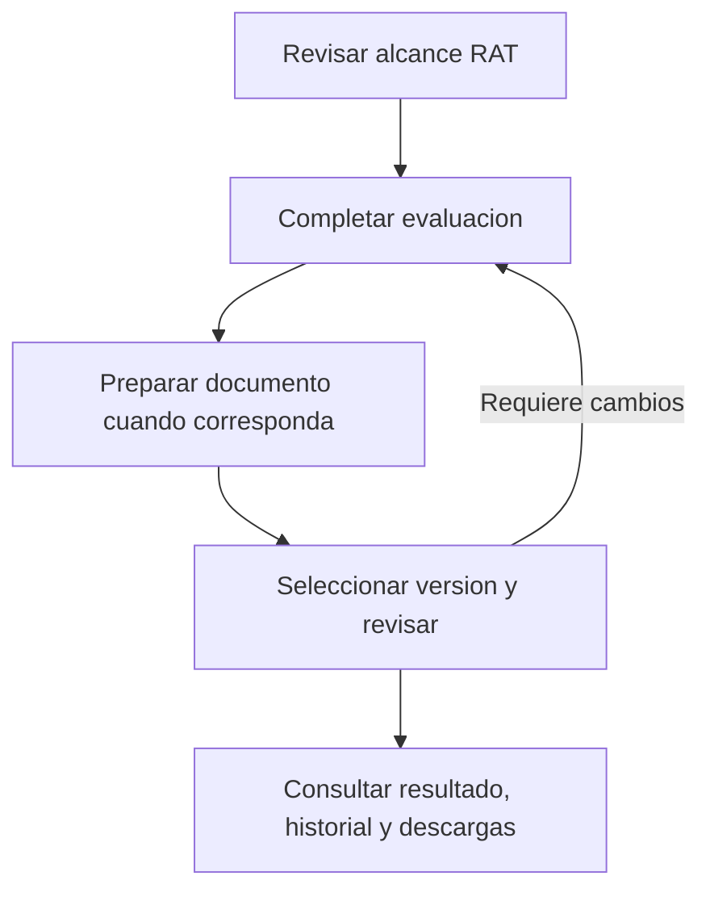

# Propuesta de experiencia de licitud

Estado: propuesta aceptada; maqueta navegable V3 actualizada el 19/10/2026.
Reorganizacion de los formularios operativos pendiente de validar la maqueta.
Base inspeccionada: 4cb7ae1. Alcance: navegacion y presentacion del flujo existente;
no ampliar reglas juridicas, facultades, API de aprobacion ni activacion EIPD.

## Problema observado

La prueba manual exigio instrucciones para encontrar acciones, diferenciar notas
editables de registros historicos y distinguir revision negativa de decision de
organizacion. Se completo un fundamento sobre version 2 consultando version 1.
ChildAdolescentPage apila expediente, editor e historial. ChildEipdHistory mezcla
creacion, consulta, decision de organizacion, copia sucesora y revision negativa.
OrganizationAcceptancePanel incluye facultades y decisiones dentro de la consulta.
Varios botones carecen de estilo reconocible. Guardar fundamento exige recargar
para actualizar paneles inferiores. El dossier presenta contenido JSON como vista
principal. La estructura actual obliga al usuario a conocer el modelo interno.

## Navegacion propuesta

Cabecera persistente: organizacion, tratamiento, finalidad, evaluacion y version,
estado documental y aviso de entorno de pruebas. Separar claramente version de
la evaluacion, numero de resolucion y etiqueta documental; nunca un unico numero
ambiguo. En revisiones indicar siempre documento/referencia/version objetivo.

Cuatro pestanas por intencion:

| Pestana | Contenido | Accion principal |
| --- | --- | --- |
| Resumen y siguientes pasos | Esquema, situacion por seccion, pendientes y motivos | Continuar tarea pendiente |
| Completar datos | Alcance RAT asociado, base/fundamento, LIA disponible, infancia y preparacion documental segun corresponda | Guardar borrador y continuar |
| Revisar documentos | Seleccion explicita de documento/version, lectura y formularios separados de revision y decision organizacional | Registrar revision o decision identificada |
| Historial y descargas | Versiones, revisiones, decisiones, facultades y expediente | Consultar o descargar |

Facultades: acceso secundario Gestionar facultades visible segun permisos,
fuera del formulario de revision. La persona revisora ve su estado y motivo de
bloqueo; la administracion puede gestionar otorgamiento/revocacion. Mantener
lecturas historicas disponibles segun permisos actuales.

## Esquema de trabajo

El retorno al editor conserva el historial; un documento registrado se corrige
preparando otra version. La revision y la decision organizacional tienen facultades
y contratos propios; este esquema no impone una secuencia juridica universal.

Revisar alcance RAT -> Completar evaluacion -> Preparar documento/version cuando
corresponda -> Revisar version seleccionada -> Registrar revision/decision segun
facultad -> Consultar historial/exportar. Requiere cambios vuelve a preparar
borrador o nueva version; no modifica el registro historico. No continuar mantiene
el resultado visible sin ofrecer activacion. Los pasos documentales no equivalen
a autorizacion juridica y no todos aplican a todas las evaluaciones.

Resumen ofrece siguiente accion contextual, no un porcentaje general de cumplimiento.
Ejemplos: completar fuente, guardar cambios, seleccionar version, revisar documento
o facultad revocada. Estado separado: sin iniciar, borrador guardado, cambios sin
guardar, pendiente de revision, requiere cambios, no continuar y solo consulta.
No mostrar revisado/aprobado por el mero guardado, ni inferir una EIPD obligatoria
solo por nombre de tratamiento o seleccion de infancia. Usar contrato/diagnostico
servidor y explicar cuando no permite determinar el siguiente paso.

## Completar datos

Secciones cortas con indice propio: alcance, base/fundamento, analisis disponibles,
infancia cuando corresponda, documento EIPD cuando proceda. Por seccion indicar
objetivo, quien completa, campos requeridos para guardar y pendientes documentales.
Mostrar resumen RAT en lectura y enlace para editarlo; advertir diferencias con
el snapshot asociado sin sobrescribirlo. No presentar nueve campos LIA como un
cuestionario juridico completo. Distinguir borrador editable y version registrada.
Guardar borrador y continuar solo avanza tras respuesta confirmada; guardar no
registra automaticamente resolucion, revision ni decision inmutable.

## Revisar documentos

Lista de versiones con referencia y estado, seleccion visible y lectura resumida
antes del formulario. Dos acciones identificadas: Revision del documento (contrato
actual solo requiere cambios/no continuar) y Decision documental de organizacion
(con facultad vigente). No son pasos obligatoriamente consecutivos ni equivalentes.
Mostrar fecha, alcance y version objetivo junto al boton final; confirmar objetivo
al registrar un evento inmutable. Crear nueva version desde esta seccion conduce
al editor, informa origen y no guarda automaticamente.

Cada bloqueo explica su causa junto al control: falta declaracion ficticia,
facultad revocada, solo lectura, material cambiado, resultado incierto o escritura
de pruebas deshabilitada. Distinguir permiso de editar, revisar y decidir. No
preseleccionar una decision favorable. No ocultar el historial al revocar facultad.

## Presentacion y estados

Botones primarios visibles, secundarios con borde y enlaces solo para navegacion.
Etiquetas junto a controles, ayudas cortas, campos condicionales justificados,
resumen legible antes de detalles tecnicos/JSON. Aviso global persistente de pruebas
y avisos especificos en acciones, evitando repetir parrafos identicos por panel.
Fechas locales legibles con UTC accesible en detalle; hashes en detalle tecnico.

Datos cargados del servidor indican borrador guardado; editar marca cambios sin
guardar. Al cambiar pestana o version, preservar borrador o permitir guardar/seguir
editando/descartar explicitamente. Nunca perder datos por desmontar componentes.
Tras guardar, refrescar datos y diagnosticos dependientes automaticamente; impedir
operaciones contra material obsoleto y no mostrar exito ante respuesta incierta.
Navegacion por teclado, foco visible, roles de pestanas, enlaces directos que
conserven organizacion/evaluacion/version y vista movil sin formularios comprimidos.

## Implementacion propuesta y verificacion

Un bloque coherente de experiencia: estructura de cuatro pestanas y esquema,
separacion de editor/consulta/revision/facultades, contexto de version compartido,
estados de guardado/bloqueo y refresco de dependencias. Reutilizar servicios y
contratos existentes; no cambiar politicas ni migrar historiales. Separar el criterio
de completitud de fuentes como tarea de validacion con contrato propio.

Antes de implementar: maqueta navegable con escenarios adulto, infancia y facultad
revocada para comprobar nombres y transiciones. Luego implementacion y pruebas
centradas en riesgos: cambios entre pestanas sin perdida, version objetivo exacta,
roles y revocacion, contexto actualizado tras guardar, respuestas inciertas,
conservacion de historial y lectura/exportacion con escrituras deshabilitadas.
Validacion asistida: usuario identifica sin ayuda donde completar, donde revisar,
que version revisa, por que una accion esta bloqueada y que sigue. EIPD y datos
reales bloqueados antes y despues. No ampliar alcance a habilitar aprobaciones.

## Aceptacion y siguiente entrega

El usuario acepta la propuesta y autoriza su documentacion, commit y push.
Proximo entregable: maqueta navegable de las cuatro pestanas con los escenarios
adultos, infancia y facultad revocada; validar claridad de nombres, version objetivo
y siguiente accion antes de modificar los formularios existentes. La maqueta debe
identificar los datos simulados y no registrar eventos ni cambiar configuraciones.
La implementacion y sus pruebas se ejecutaran como bloque posterior; no se marcan
como realizadas por aprobar o publicar este documento.

Criterios de aceptacion del bloque de experiencia:

- Identificar donde completar, revisar y consultar historial sin instrucciones externas.
- Mostrar siempre documento y version objetivo junto a una revision o decision.
- Conservar cambios al navegar y distinguir guardado confirmado, cambios pendientes
  y resultado incierto; sin recarga manual obligatoria tras guardar.
- Explicar el motivo de cada bloqueo y mantener consulta historica tras revocacion.
- Mostrar pasos aplicables y siguiente accion sin equivaler avance a aprobacion juridica.
- Mantener permisos de servidor, aislamiento, registros inmutables y bloqueos EIPD/datos reales.
- Verificar teclado, foco, pantallas pequenas y los tres escenarios con el usuario.

Backlog de referencia: LIC-UX-004 integra esta reorganizacion y recoge LIC-UX-002,
LIC-UX-003 y el patron de guardado RAT-UX-001 cuando corresponda. RAT-VAL-001
mantiene su propio contrato de completitud; no se considera resuelto por el rediseno.

## Maqueta navegable disponible — version 3

Ruta protegida `/dashboard/licitud/maqueta`, acceso desde Bases de licitud.
Seleccionar tratamiento/finalidad antes de cuatro pestanas. Ejemplos opcionales
solo precargan seleccion; facultad simulada vigente/revocada sigue independiente.
No usa API/DB ni cambia permisos, configuracion o formularios operativos.

V3, 19/10/2026: Completar datos conserva solo Alcance del RAT y Base/fundamento;
Infancia se agrega cuando corresponde al ejemplo. Numeracion consecutiva segun
secciones visibles. Resumen de alcance en cuatro lineas. Aviso de cambios sin
guardar dentro del formulario, destacado; no implica persistencia en servidor.

Preparar documento para revision es una accion, no otra seccion dedicada a notas.
Muestra referencia/version propuesta (inicia DEMO-3, tras dos fixtures), organizacion,
tratamiento, finalidad, titulares, categoria, fuente, base, fundamento y analisis de
infancia cuando existe. Notas especificas opcionales incluidas en la vista previa.
Pendientes explicitos: campos vacios y analisis/revision juridica/evidencias que el
ejemplo deja pendientes; no es diagnostico juridico exhaustivo. No exigir notas.

El responsable ficticio revisa la vista previa y puede volver a fundamento,
infancia o alcance. Registrar exige confirmar lectura del contenido mostrado;
si cambia, la confirmacion se invalida. Es revision preparatoria del ensayo, no
aceptacion juridica, otorgamiento de facultad ni aprobacion EIPD. La revision del
documento y decision organizacional siguen separadas en Revisar documentos.

Simular registro conserva una copia completa independiente del borrador, solo en
memoria de la visita. Queda pendiente de revision; historico consultable con
version explicita. Editar despues no modifica la copia anterior; preparar/registrar
otra crea DEMO-4 y siguientes. Nuevas versiones por tratamiento/finalidad;
observaciones por version. Doble contexto: version de evaluacion 1 y version
documental explicita. Facultad revocada bloquea decision organizacional, conserva
edicion/consulta del ensayo y no otorga permisos reales.

Historial incluye fixtures y versiones de la visita. JSON de fixture excluye textos
editados; JSON de version simulada incluye su copia completa, notas y pendientes,
no cambios posteriores del borrador. Exporta tipo ficticios, contains_user_edits
segun origen, lectura preparatoria simulada, persisted_events=0 para servidor y
numero de versiones locales; authorizes_action=false, activation=deshabilitada,
allows_real_data=false. No es un expediente operativo ni prueba de aceptacion.

Nada se persiste en navegador/servidor: recargar reinicia borradores/versiones.
Enlace a version local inexistente tras recarga informa y vuelve al fixture DEMO-2.
Fragmento conserva seleccion/version, no contenido. Enlaces V1/V2 compatibles.
Roles de pestanas, flechas/Home/End, foco y vista movil conservados.

Visita guiada del usuario sobre V2: observadas seleccion/edicion, conservacion al
navegar, observaciones por version, descarga ficticia, bloqueo organizacional con
facultad revocada y edicion de infancia. Usuario confirma en prueba controlada
separacion y conservacion de borradores entre finalidades durante la visita; no
acredita persistencia tras recarga. Hallazgos de presentacion integrados en V3.

Validacion local V3: 13 Chromium dirigidas aprobadas; tipos frontend, ESLint de
archivos modificados, Prettier y git diff --check aprobados. Nuevos casos verifican
contenido/faltantes, lectura invalidada al cambiar, regreso a editar, copia completa
con infancia/notas, descarga exacta, nuevas versiones sin mutar antiguas, aislamiento
por finalidad y reinicio al recargar. Capturas de preparacion inspeccionadas en
390 px y 1280 px. Suite existente: `npx playwright test e2e/licitud-prototype.spec.ts`.
Sin cambios backend, sin repetir DB ni pruebas amplias locales. CI exacta del nuevo
commit se consulta tras push; no atribuirle ejecuciones de commits anteriores.

Pendiente validar con usuario el nuevo ciclo preparar/revisar/registrar/corregir;
no desplegarlo en formularios operativos hasta validar el diseno. LIC-UX-004 abierto;
RAT-VAL-001 sigue separado. EIPD/datos reales bloqueados; sin merge/despliegue.
